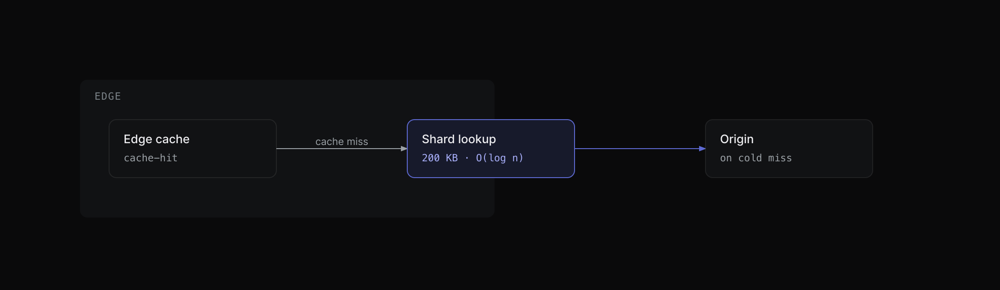
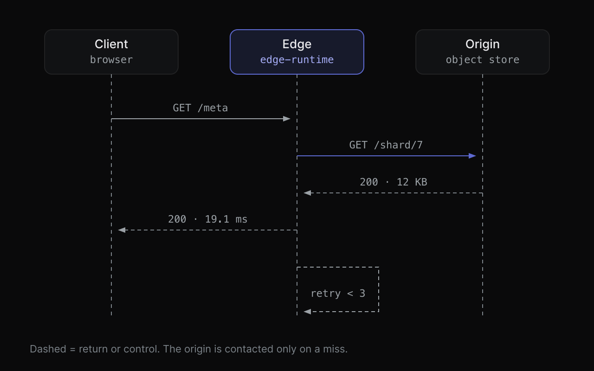
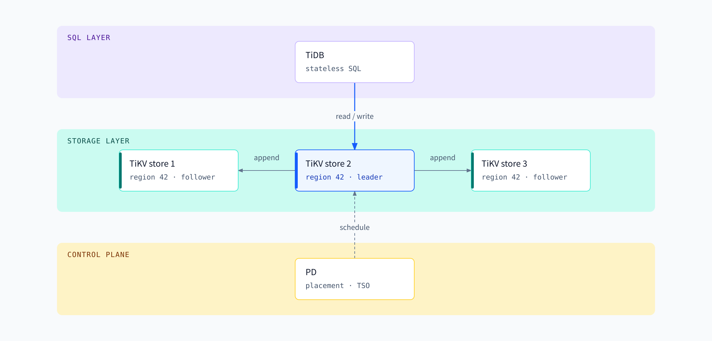

# skills

[English](README.md) · [简体中文](README.zh-CN.md)

Agent skills by [@Loner1024](https://github.com/Loner1024). Each skill is a self-contained folder
following the [Agent Skills specification](https://agentskills.io): a `SKILL.md` with YAML
frontmatter plus the references, assets, and scripts it needs.

Install any of them into Claude Code, Codex, Cursor, Droid, OpenCode, Zed, or one of the
[other supported agents](https://github.com/vercel-labs/skills#supported-agents) with one command.

[](https://skills.sh/Loner1024/skills)

## Install

```bash
# see what is in here
npx skills add Loner1024/skills --list

# interactive picker: choose skills, agents, and scope
npx skills add Loner1024/skills

# non-interactive: one skill, global scope, to specific agents
npx skills add Loner1024/skills --skill tech-diagrams -g -a claude-code -a codex -a droid -y

# everything, to every agent you have installed
npx skills add Loner1024/skills --all
```

Without installing, you can load a single skill into an agent for one session:

```bash
npx skills use Loner1024/skills@tech-diagrams | claude
```

Update later with `npx skills update -g`, and remove with `npx skills remove <skill>`.

## Skills

| Skill | What it does | Requirements |
| --- | --- | --- |
| [`tech-diagrams`](skills/tech-diagrams) | Draws publication-quality technical figures as hand-authored SVG plus a self-contained HTML preview, and lints them before delivering. 14 figure types, from architecture topology to sequence, state machine, benchmark bars, and terminal window frames. Also decides **when not to draw**. | `python3`, `rsvg-convert`, Chrome/Chromium (for HTML previews) |
| [`codebase-design`](skills/codebase-design) | Designs and reviews deep modules: exact vocabulary, seam placement, the shape behind the seam, eight design red flags, and a review checklist. | none |
| [`architecture-ablation`](skills/architecture-ablation) | Tests whether a component, layer, or mechanism earns its place by removing or replacing it and comparing the result against a baseline. Turns "is this abstraction doing anything?" into a decision backed by evidence you can recheck. | none |
| [`external-agent-handoff`](skills/external-agent-handoff) | Packs a task into a handoff document and a copy-ready prompt for an external agent the user forwards, then checks the returned work against the acceptance criteria. The current agent does not call the external agent. | none |
| [`web-craft`](skills/web-craft) | One entry point for web interface craft: classifies the job, routes to one of fourteen design-engineering modules carried verbatim (UI polish, motion, review, performance, prototyping, mobile feel), and follows that module's rules unchanged. | none |
| [`unslop`](skills/unslop) | Removes AI tells from writing: 33 numbered rules in 8 groups, each naming a pattern and its fix, run as scan → rewrite → self-audit. | none |
| [`deslop`](skills/deslop) | Removes AI-generated code slop from a branch diff: comments that restate the line, defensive checks on trusted paths, `any` casts, deep nesting, and patterns that disagree with the surrounding file. | none |
| [`create-verification-skill`](skills/create-verification-skill) | Generates a project-local verification skill that drives the real app the way a user does — launch, doctor, drive, evidence, cleanup — seeds a per-feature verification map, and proves the generated skill end to end before handing it over. | none |

## tech-diagrams

Most agent-made diagrams are Mermaid block layouts: every box the same size, arrows that start in
empty space, labels the boxes paint over. This skill encodes the opposite approach, derived from a
close reading of how Linear, Cursor, Vercel, Anthropic, and OpenAI actually present figures in
their technical writing. The per-company evidence lives in [`research/`](research); the skill does
not read it.

It delivers two artifacts per figure:

| Artifact | Purpose |
| --- | --- |
| `<slug>.html` | Self-contained preview: inline SVG plus inlined design tokens, no external requests, opens offline |
| `<slug>.svg` | Single-file deliverable for a README, a doc, a blog post, or a slide |

Plus a caption line that doubles as the image `alt`, and one sentence on what the figure
deliberately leaves out.







### What it enforces

- **One claim per figure**, stated in the caption, which is also the `alt` text.
- **A figure only when prose cannot carry the structure**: comparisons of more than three things,
  multi-step causality, state that changes over time, or measurements where rank matters.
  Otherwise it says "use a table" and stops.
- **A geometry budget**: at most 9 nodes, at most two focal elements, a 4px grid, radii ≤ 8px, 1px strokes,
  orthogonal connectors only, 11px minimum type.
- **Connector hygiene**: both ends of every arrow land on something visible (a box border, a
  lifeline, a start dot), arrowheads never aim at a corner, no line crosses a box that is not its
  endpoint, and short arrows carry a label.
- **Colour with a job.** One accent for attention (at most two focal elements), up to three
  identity tints for parallel items and scopes (a zone band, a lane, a series, an option), and
  ok/warn/err for state only. No gradients, glows, drop shadows, or decorative chrome.
- **Contrast and CJK font stacks checked mechanically**, so the rasteriser cannot silently tofu.

### Workflow

```bash
cd skills/tech-diagrams

# 1. start from a template (dark is the default register)
mkdir -p figures && cp assets/template-dark.html figures/my-figure.html

# 2. check the source, then look at the raster
python3 scripts/self_check.py figures/my-figure.html --strict
./scripts/render.sh figures/my-figure.html --scale 2

# 3. lint the source against its own render (catches blank and over-sparse output)
./scripts/render.sh figures/my-figure.svg --scale 2
python3 scripts/self_check.py figures/my-figure.svg --png figures/my-figure.png

# after editing the reference docs, prove the snippets inside them still pass
python3 scripts/lint_docs.py
```

The renderer needs `rsvg-convert` (`brew install librsvg` on macOS) for SVG and a headless
Chrome/Chromium for HTML previews. The linter is stdlib-only Python. Figures were authored and
rendered on macOS; `rsvg-convert` and Chrome resolve fonts differently elsewhere, which is why the
CJK stack is listed explicitly.

### Honest limits

The linter checks what can be checked. Visual taste, line weight, and whether the figure actually
persuades still need a human eye on the PNG. If the agent cannot view images in a session, it says
so and hands you the render for the final look.

## codebase-design

A vocabulary and workflow for designing deep modules: a lot of behaviour behind a small interface,
at a clean seam, testable through that interface. It gives the agent exact terms (module, interface,
implementation, depth, seam, adapter, leverage, locality) so "component", "service", and "API" stop
standing in for different things.

The design mode writes the caller's usage first, chooses the data shape behind the seam, classifies
the dependency to place the seam, explores three alternative interfaces, and screens eight red flags
that agents reliably introduce: shallow modules, information leakage, temporal decomposition,
pass-through methods, split ownership, two ways to do one task, importable internals, and hand-synced
lists.

The review mode applies the deletion test, depth, reader load, boundary placement, and the test
surface. It reports only findings that would change a decision, with evidence and a fix. It does not
decide whether a service, cache, or queue should exist; that is `architecture-ablation`.

## architecture-ablation

Ask an agent "do we need this queue?" and you usually get an opinion. This skill makes it produce a
comparison instead: fix the constraints that must survive, remove or replace one mechanism at a
time, and attribute the result to evidence with a label.

It forces a few things that arguments usually skip:

- **A baseline before any removal.** The constraints, the critical call paths, and the state
  ownership of the original design get written down first. If the baseline already fails in the
  scenario at issue, that is recorded as a failure — "both variants fail" is not a passing
  simplification.
- **Assumptions in a fixed shape**, so they can be tracked: `[assumption] <statement> → if false, it
  affects <which conclusion>`.
- **Evidence labels instead of confident prose.** Every claim is `measured`, `design walkthrough`,
  or `unverified`, and an expected result is never written as though it had already passed.
- **Four decisions, not two**: remove or replace, keep, defer, or unverified. A "keep" has to name
  the scenario that fails without the mechanism; a "defer" has to name the observable condition that
  brings it back.
- **Individually passing removals are not a jointly passing removal.** Mechanisms with overlapping
  responsibility get re-verified as a combination.
- **Complexity that moved is not complexity that left.** The final check is whether it landed in
  callers, the operations process, or another copy of state.

The user's goal is a constraint, not a variable: the skill may name what a fixed stack or boundary
costs, but it cannot reach a simpler design by changing what the user asked for. Local refactoring
and ML model ablation are explicitly out of scope.

It delivers the recommendation plus the evidence to recheck it, and folds a single decision into an
existing design doc or ADR rather than generating a duplicate report.

## external-agent-handoff

When the work should run on another agent, this skill keeps the current one from doing that job
itself or calling the other agent. It writes the plan and the checks first, then a document and a
prompt the user can forward unchanged.

It forces a few things that a loose "here, send this" usually skips:

- **A document the other agent can execute without this conversation.** Goal, start state, write
  scope, deliverables, and one observable check per acceptance item.
- **A prompt with nothing left to fill in.** If the other agent can open the document, the prompt
  points at it. Otherwise the prompt carries the instructions.
- **A stop after the handoff.** Status stays "waiting for external execution and return" until the
  user brings a result.
- **Acceptance against artifacts.** A missing file is unfinished. Each criterion gets a verdict
  from a check the current agent runs. A failure is fixed and rechecked, or sent back as a
  revision prompt.

## web-craft

One entry point instead of fourteen skills competing for the agent's attention. The agent sees a
single skill; that skill reads the job, routes to the module that owns it, and follows the module's
rules without softening them. A motion review does not turn into a design rewrite, and "don't
animate this" stays the answer.

The fourteen modules are [Emil Kowalski](https://github.com/emilkowalski/skills)'s
design-engineering skill set, carried verbatim under
[`modules/`](skills/web-craft/modules) with his MIT license kept alongside. Four mechanical changes
make the single entry point hold and keep the skill loadable where Amp serves it: module files are
`MODULE.md` rather than `SKILL.md` (agent-side discovery treats any nested `SKILL.md` as a skill of
its own), the two module-internal references to that filename were updated, the bundled license
carries a `.txt` extension, and the two literal U+FFFD characters in `break-ui` are written as the
escape `\uFFFD` — a hosted skill whose files contain one is not served at all. The text is
otherwise byte-identical. What this repository adds is the router:

- **Classification by job, not keywords.** "Make this popover feel right" is a motion build; "why
  does my drawer stutter" is performance; "review the motion in this diff" is a critique.
- **Explicit-only modules stay explicit.** `review-animations`, `prototype`, and `pick-ui-library`
  are entered only when the user asks for that job, names the module, or the module already routed
  to hands off to it — never as an unrequested bonus step.
- **Combinations defer to the modules.** A module's own invocation variants and handoffs
  (`execute <plan>`, `keep <variant>`) win over any sequence this repository suggests; when two
  modules claim the same job, the specialist wins.
- **The modules are never edited to fit a task.** If a module is wrong for the job, the route was
  wrong, not the module.

| Job | Routes to |
| --- | --- |
| Build or polish a UI | `emil-design-eng` |
| Add motion (web / Expo) | `animate` · `animate-expo` |
| Review UI or design code (not motion) | `emil-design-eng` |
| Review, audit, or find motion | `review-animations` · `improve-animations` · `find-animation-opportunities` |
| Motion drops frames | `animation-performance` |
| Fluid, gesture-driven interaction | `apple-design` |
| A web app on a phone | `mobile-native` |
| UI library choice · variant prototyping | `pick-ui-library` · `prototype` |
| Worst-case data | `break-ui` |
| Name an effect | `animation-vocabulary` |
| Sonner toasts | `ask-sonner` |

## unslop

Writing, not generating: point it at text and it removes the tells that make it read as
AI-generated. Thirty-three numbered rules in eight groups, from superficial -ing phrases and vague
attributions to em dash overuse, chatbot phrases, and abstract metaphor nouns. Each rule names the
pattern and the fix rather than asking for a vibe, and the process is scan → rewrite (preserve
meaning, match tone) → self-audit.

The rule numbers are stable ids that other skills cite, so a removed rule leaves a gap on purpose.
Keep the numbering when editing the file.

## deslop

The code half of the same idea. It reads the diff against main and removes what a model added
without being asked: comments that restate the line, defensive checks and try/catch blocks that are
abnormal for trusted paths, `any` casts that only bypass a type error, nesting that wants an early
return, and patterns that disagree with the surrounding file.

Its guardrails are the point: behavior stays unchanged unless it is fixing a clear bug, minimal
edits beat broad rewrites, and the summary is 1-3 sentences.

## create-verification-skill

Generates a project-local verification skill (`<skills>/verify-<app>/`) for the target repo. It
interviews the codebase first, not the user: what surface a user touches, how the app starts, how an
agent can drive it, what evidence can be captured, and whether two instances can run side by side.
The generated `SKILL.md` has six sections, Launch, Doctor, Drive, Evidence, Cleanup, and Helpers,
each grounded in what the interview found, with no placeholders.

It then seeds a feature map: a `features/README.md` index plus one file per user-facing feature, with
the four H2s `Sub-features`, `How to get to it (user POV)`, `Driving it with <harness>`, and
`Gotchas`; the example is in `references/feature-map-example/`. The generated skill must be run end
to end once (launch, doctor, drive one feature, evidence, cleanup, with the evidence still present
after cleanup); an unrun generated skill is a draft. As the app changes, the feature map is kept
honest by updating the files under `features/`.

## Repository layout

```
research/                        provenance, not part of any skill
  FINDINGS.md                    how the five companies present figures, per company, with links
  TAXONOMY.md                    the decision taxonomy and tooling survey behind the rules
scripts/
  sync-to-amp-skills.sh          copy skills/ into the maintainer's Amp personal skills repository
skills/
  tech-diagrams/
    SKILL.md                     entry point: workflow, routing table, hard rules
    references/                  when-to-draw · registers · primitives · type-* · verification · export
    assets/                      tokens.css + dark and light starting templates
    scripts/                     render.sh · self_check.py · lint_docs.py
    examples/                    eight finished figures across the four type families
  codebase-design/
    SKILL.md                     entry point: vocabulary, design mode, review mode, handoff
    references/                  red-flags.md · shape.md
    agents/openai.yaml           interface metadata: display name, triggers, not-triggers
  architecture-ablation/
    SKILL.md                     entry point: baseline, ablation loop, decision table
    agents/openai.yaml           interface metadata: display name, triggers, not-triggers
  external-agent-handoff/
    SKILL.md                     entry point: handoff document, forward prompt, acceptance
    agents/openai.yaml           interface metadata: display name, triggers, not-triggers
  web-craft/
    SKILL.md                     the single entry point: dispatch rules, routing table, combinations
    agents/openai.yaml           interface metadata: display name, triggers, not-triggers
    modules/                     14 modules, verbatim from emilkowalski/skills, plus its MIT LICENSE
  unslop/
    SKILL.md                     writing: 33 numbered rules that remove AI tells
    agents/openai.yaml           interface metadata: display name, triggers, not-triggers
  deslop/
    SKILL.md                     code: remove AI-generated slop from a branch diff
    agents/openai.yaml           interface metadata: display name, triggers, not-triggers
  create-verification-skill/
    SKILL.md                     entry point: interview, generate, seed map, prove, maintain
    references/feature-map-example/  README + three feature files
```

`skills/<name>/` is the install unit: that is the whole directory `npx skills` copies. Every skill
here is self-contained and reads nothing outside its own folder, so a skill behaves identically
from a clone of this repo and from an installed copy.

`research/` is the exception by design: it is in the repo for a human deciding whether to trust a
rule, and nothing under `skills/` reads it. Delete the folder and every skill still works. It is
written in Chinese; the operational rules are the English files under
`skills/tech-diagrams/references/`.

## Adding a skill

```
skills/<skill-name>/SKILL.md     # frontmatter needs name and description; lowercase-hyphenated name
```

Commit, push, and it becomes installable immediately: `npx skills add Loner1024/skills --list`
picks up anything under `skills/`. Keep each skill self-contained, put anything it only needs at
runtime inside its own folder, and prefer scripts over prose when a rule can be verified
mechanically.

## License

[MIT](LICENSE). Third-party material is attributed where it appears.
