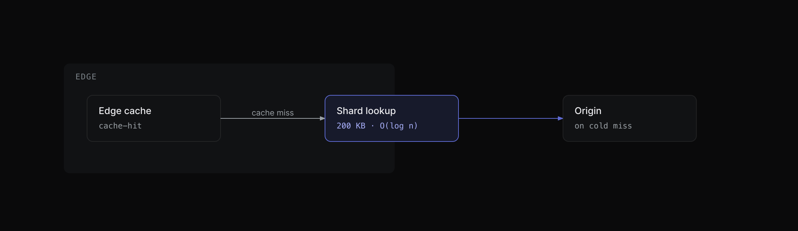
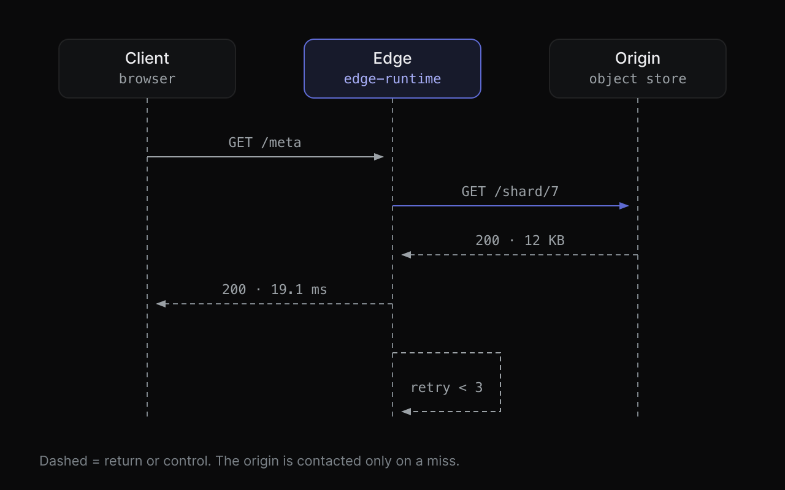
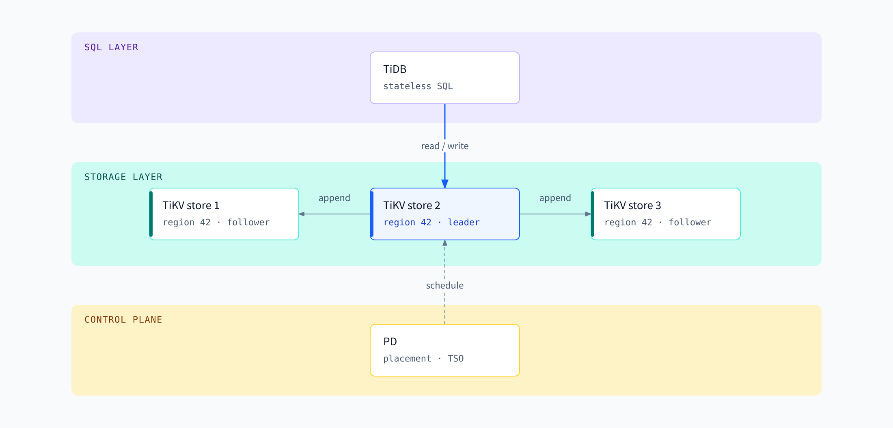

# skills

[English](README.md) · [简体中文](README.zh-CN.md)

Agent skills by [@Loner1024](https://github.com/Loner1024). Each skill is a self-contained folder
following the [Agent Skills specification](https://agentskills.io): a `SKILL.md` with YAML
frontmatter plus the references, assets, and scripts it needs.

Install any of them into Claude Code, Codex, Cursor, Droid, OpenCode, Zed, or one of the
[other supported agents](https://github.com/vercel-labs/skills#supported-agents) with one command.

[](https://skills.sh/Loner1024/skills)

## Install

```bash
# see what is in here
npx skills add Loner1024/skills --list

# interactive picker: choose skills, agents, and scope
npx skills add Loner1024/skills

# non-interactive: one skill, global scope, to specific agents
npx skills add Loner1024/skills --skill tech-diagrams -g -a claude-code -a codex -a droid -y

# everything, to every agent you have installed
npx skills add Loner1024/skills --all
```

Without installing, you can load a single skill into an agent for one session:

```bash
npx skills use Loner1024/skills@tech-diagrams | claude
```

Update later with `npx skills update -g`, and remove with `npx skills remove <skill>`.

## Skills

| Skill | What it does | Requirements |
| --- | --- | --- |
| [`tech-diagrams`](skills/tech-diagrams) | Draws publication-quality technical figures as hand-authored SVG plus a self-contained HTML preview, and lints them before delivering. 14 figure types, from architecture topology to sequence, state machine, benchmark bars, and terminal window frames. Also decides **when not to draw**. | `python3`, `rsvg-convert`, Chrome/Chromium (for HTML previews) |
| [`codebase-design`](skills/codebase-design) | Designs and reviews deep modules: exact vocabulary, seam placement, the shape behind the seam, eight design red flags, and a review checklist. | none |
| [`architecture-ablation`](skills/architecture-ablation) | Tests whether a component, layer, or mechanism earns its place by removing or replacing it and comparing the result against a baseline. Turns "is this abstraction doing anything?" into a decision backed by evidence you can recheck. | none |
| [`external-agent-handoff`](skills/external-agent-handoff) | Packs a task into a handoff document and a copy-ready prompt for an external agent the user forwards, then checks the returned work against the acceptance criteria. The current agent does not call the external agent. | none |
| [`web-craft`](skills/web-craft) | One entry point for web interface craft: classifies the job, routes to one of fourteen design-engineering modules carried verbatim (UI polish, motion, review, performance, prototyping, mobile feel), and follows that module's rules unchanged. | none |
| [`unslop`](skills/unslop) | Removes AI tells from writing: 33 numbered rules in 8 groups, each naming a pattern and its fix, run as scan → rewrite → self-audit. | none |
| [`deslop`](skills/deslop) | Removes AI-generated code slop from a branch diff: comments that restate the line, defensive checks on trusted paths, `any` casts, deep nesting, and patterns that disagree with the surrounding file. | none |
| [`create-verification-skill`](skills/create-verification-skill) | Generates a project-local verification skill that drives the real app the way a user does — launch, doctor, drive, evidence, cleanup — seeds a per-feature verification map, and proves the generated skill end to end before handing it over. | none |
| [`writing-for-agents`](skills/writing-for-agents) | Writes and prunes the documents an agent consumes: a skill, an `AGENTS.md` / `CLAUDE.md`, or a doc reached by pointer. Covers trigger wording, information hierarchy, completion criteria, leading words, and pruning, plus frontmatter and model- vs user-invocation. | none |
| [`reflect`](skills/reflect) | Runs a retrospective on a coding session with the agent's environment as its subject: three independent lenses (judgment, tooling, divergent) find durable findings, a synthesizer keeps only what a future agent would act on, and each accepted row is ranked by frequency times cost and routed to a check, a skill, a steering file, or a doc. Proposes; the user approves rows before any edit lands. | none |
| [`design-practice`](skills/design-practice) | Product design around the code, in six routes: critique a screen, audit or document a design system, spec a developer handoff, write or review UX copy, plan user research, synthesize interviews and usability notes. Carries Anthropic's design plugin as modules. | none |
| [`nuclear-review`](skills/nuclear-review) | Reviews a diff at the harshest maintainability bar: hunts the code-judo restructuring that deletes branches, helpers, and layers; blocks unjustified 1k-line growth and special-case spaghetti; the bar for approval sits above "tests pass". Carried from Cursor's `thermo-nuclear-code-quality-review`. | none |
| [`technical-writing`](skills/technical-writing) | Writes documentation a tired engineer understands on the first read: picks one Diátaxis mode, then applies Google developer style, STE instruction rules, and Global English. Covers READMEs, RFCs, design docs, PR descriptions, and commit messages. | none |
| [`blast-radius`](skills/blast-radius) | Finds what a change breaks outside the diff before it ships, and proves the one fact the safety argument rests on by running real code. Ranks each risk by likelihood and cost, and separates what it cleared from what it could not. | none |
| [`benchmark-checklist`](skills/benchmark-checklist) | Vets a performance number before anyone reports or acts on it: names the limiter, checks both sides were tuned, does the arithmetic against physical limits, counts errors, and runs alternating repeats so noise cannot pass as a win. | none |
| [`tdd`](skills/tdd) | Fixes a bug through a regression test that fails before the change and passes after it, and says when no cheap test path exists instead of building an expensive harness. | none |
| [`correct`](skills/correct) | Turns a repeated agent mistake into something the repo enforces: architecture first, then types, then a lint whose error names the fix, then a test, and docs last. Proves each new check fails on a real past mistake. | none |
| [`sharpen`](skills/sharpen) | Rewrites a shallow request into a deeper one without adding scope: four questions about what a top professional would do differently, what raw material they would start from, which methods and tools they would use, and what outside the agent would prove the result right. User-invoked with `/sharpen`. | none |
| [`how`](skills/how) | Explains how a subsystem works: splits a large system into 2-4 exploration angles, then synthesizes one onboarding-grade account with components, runtime flow, a file map, and gotchas. | none |
| [`why`](skills/why) | Traces why code is shaped the way it is: anchors the code, searches every available evidence source (git and PRs, tickets, docs, chat, observability, errors, analytics), and reports with five confidence tiers, citations, contradictions, and named gaps. | MCP servers for the non-git sources (optional; git and `gh` always work) |

## tech-diagrams

Most agent-made diagrams are Mermaid block layouts: every box the same size, arrows that start in
empty space, labels the boxes paint over. This skill encodes the opposite approach, derived from a
close reading of how Linear, Cursor, Vercel, Anthropic, and OpenAI actually present figures in
their technical writing. The per-company evidence lives in [`research/`](research); the skill does
not read it.

It delivers two artifacts per figure:

| Artifact | Purpose |
| --- | --- |
| `<slug>.html` | Self-contained preview: inline SVG plus inlined design tokens, no external requests, opens offline |
| `<slug>.svg` | Single-file deliverable for a README, a doc, a blog post, or a slide |

Plus a caption line that doubles as the image `alt`, and one sentence on what the figure
deliberately leaves out.







### What it enforces

- **One claim per figure**, stated in the caption, which is also the `alt` text.
- **A figure only when prose cannot carry the structure**: comparisons of more than three things,
  multi-step causality, state that changes over time, or measurements where rank matters.
  Otherwise it says "use a table" and stops.
- **A geometry budget**: at most 9 nodes, at most two focal elements, a 4px grid, radii ≤ 8px, 1px strokes,
  orthogonal connectors only, 11px minimum type.
- **Connector hygiene**: both ends of every arrow land on something visible (a box border, a
  lifeline, a start dot), arrowheads never aim at a corner, no line crosses a box that is not its
  endpoint, and short arrows carry a label.
- **Colour with a job.** One accent for attention (at most two focal elements), up to three
  identity tints for parallel items and scopes (a zone band, a lane, a series, an option), and
  ok/warn/err for state only. No gradients, glows, drop shadows, or decorative chrome.
- **Contrast and CJK font stacks checked mechanically**, so the rasteriser cannot silently tofu.

### Workflow

```bash
cd skills/tech-diagrams

# 1. start from a template (dark is the default register)
mkdir -p figures && cp assets/template-dark.html figures/my-figure.html

# 2. check the source, then look at the raster
python3 scripts/self_check.py figures/my-figure.html --strict
./scripts/render.sh figures/my-figure.html --scale 2

# 3. lint the source against its own render (catches blank and over-sparse output)
./scripts/render.sh figures/my-figure.svg --scale 2
python3 scripts/self_check.py figures/my-figure.svg --png figures/my-figure.png

# after editing the reference docs, prove the snippets inside them still pass
python3 scripts/lint_docs.py
```

The renderer needs `rsvg-convert` (`brew install librsvg` on macOS) for SVG and a headless
Chrome/Chromium for HTML previews. The linter is stdlib-only Python. Figures were authored and
rendered on macOS; `rsvg-convert` and Chrome resolve fonts differently elsewhere, which is why the
CJK stack is listed explicitly.

### Honest limits

The linter checks what can be checked. Visual taste, line weight, and whether the figure actually
persuades still need a human eye on the PNG. If the agent cannot view images in a session, it says
so and hands you the render for the final look.

## codebase-design

A vocabulary and workflow for designing deep modules: a lot of behaviour behind a small interface,
at a clean seam, testable through that interface. It gives the agent exact terms (module, interface,
implementation, depth, seam, adapter, leverage, locality) so "component", "service", and "API" stop
standing in for different things.

The design mode writes the caller's usage first, chooses the data shape behind the seam, classifies
the dependency to place the seam, explores three alternative interfaces, and screens eight red flags
that agents reliably introduce: shallow modules, information leakage, temporal decomposition,
pass-through methods, split ownership, two ways to do one task, importable internals, and hand-synced
lists.

The review mode applies the deletion test, depth, reader load, boundary placement, and the test
surface. It reports only findings that would change a decision, with evidence and a fix. It does not
decide whether a service, cache, or queue should exist; that is `architecture-ablation`.

## architecture-ablation

Ask an agent "do we need this queue?" and you usually get an opinion. This skill makes it produce a
comparison instead: fix the constraints that must survive, remove or replace one mechanism at a
time, and attribute the result to evidence with a label.

It forces a few things that arguments usually skip:

- **A baseline before any removal.** The constraints, the critical call paths, and the state
  ownership of the original design get written down first. If the baseline already fails in the
  scenario at issue, that is recorded as a failure — "both variants fail" is not a passing
  simplification.
- **Assumptions in a fixed shape**, so they can be tracked: `[assumption] <statement> → if false, it
  affects <which conclusion>`.
- **Evidence labels instead of confident prose.** Every claim is `measured`, `design walkthrough`,
  or `unverified`, and an expected result is never written as though it had already passed.
- **Four decisions, not two**: remove or replace, keep, defer, or unverified. A "keep" has to name
  the scenario that fails without the mechanism; a "defer" has to name the observable condition that
  brings it back.
- **Individually passing removals are not a jointly passing removal.** Mechanisms with overlapping
  responsibility get re-verified as a combination.
- **Complexity that moved is not complexity that left.** The final check is whether it landed in
  callers, the operations process, or another copy of state.

The user's goal is a constraint, not a variable: the skill may name what a fixed stack or boundary
costs, but it cannot reach a simpler design by changing what the user asked for. Local refactoring
and ML model ablation are explicitly out of scope.

It delivers the recommendation plus the evidence to recheck it, and folds a single decision into an
existing design doc or ADR rather than generating a duplicate report.

## external-agent-handoff

When the work should run on another agent, this skill keeps the current one from doing that job
itself or calling the other agent. It writes the plan and the checks first, then a document and a
prompt the user can forward unchanged.

It forces a few things that a loose "here, send this" usually skips:

- **A document the other agent can execute without this conversation.** Goal, start state, write
  scope, deliverables, and one observable check per acceptance item.
- **A prompt with nothing left to fill in.** If the other agent can open the document, the prompt
  points at it. Otherwise the prompt carries the instructions.
- **A stop after the handoff.** Status stays "waiting for external execution and return" until the
  user brings a result.
- **Acceptance against artifacts.** A missing file is unfinished. Each criterion gets a verdict
  from a check the current agent runs. A failure is fixed and rechecked, or sent back as a
  revision prompt.

## web-craft

One entry point instead of fourteen skills competing for the agent's attention. The agent sees a
single skill; that skill reads the job, routes to the module that owns it, and follows the module's
rules without softening them. A motion review does not turn into a design rewrite, and "don't
animate this" stays the answer.

The fourteen modules are [Emil Kowalski](https://github.com/emilkowalski/skills)'s
design-engineering skill set, carried verbatim under
[`modules/`](skills/web-craft/modules) with his MIT license kept alongside. Four mechanical changes
make the single entry point hold and keep the skill loadable where Amp serves it: module files are
`MODULE.md` rather than `SKILL.md` (agent-side discovery treats any nested `SKILL.md` as a skill of
its own), the two module-internal references to that filename were updated, the bundled license
carries a `.txt` extension, and the two literal U+FFFD characters in `break-ui` are written as the
escape `\uFFFD` — a hosted skill whose files contain one is not served at all. The text is
otherwise byte-identical. What this repository adds is the router:

- **Classification by job, not keywords.** "Make this popover feel right" is a motion build; "why
  does my drawer stutter" is performance; "review the motion in this diff" is a critique.
- **Explicit-only modules stay explicit.** `review-animations`, `prototype`, and `pick-ui-library`
  are entered only when the user asks for that job, names the module, or the module already routed
  to hands off to it — never as an unrequested bonus step.
- **Combinations defer to the modules.** A module's own invocation variants and handoffs
  (`execute <plan>`, `keep <variant>`) win over any sequence this repository suggests; when two
  modules claim the same job, the specialist wins.
- **The modules are never edited to fit a task.** If a module is wrong for the job, the route was
  wrong, not the module.
- **Design work that is not craft goes next door.** A page built from scratch stays here, but its
  copy comes from `design-practice`'s `ux-copy` before the layout settles, and the rendered page
  goes back there for `design-critique`. A Figma file or a mockup never enters this skill.

| Job | Routes to |
| --- | --- |
| Build or polish a UI | `emil-design-eng` |
| Add motion (web / Expo) | `animate` · `animate-expo` |
| Review UI or design code (not motion) | `emil-design-eng` |
| Review, audit, or find motion | `review-animations` · `improve-animations` · `find-animation-opportunities` |
| Motion drops frames | `animation-performance` |
| Fluid, gesture-driven interaction | `apple-design` |
| A web app on a phone | `mobile-native` |
| UI library choice · variant prototyping | `pick-ui-library` · `prototype` |
| Worst-case data | `break-ui` |
| Name an effect | `animation-vocabulary` |
| Sonner toasts | `ask-sonner` |

## design-practice

Anthropic's design plugin, carried as six modules behind one router: design critique, design system,
handoff, UX copy, user research, and research synthesis. The modules are the plugin's text with its
accessibility sections removed; this repository adds the routing, a connector note, and the rules
that turn plugin commands into modules.

The seam with `web-craft` is the artifact. A Figma link, screenshot, mockup, spec, transcript, or a
line of interface copy routes here; running code routes to `web-craft`. A screen is judged here for
whether it works, and there for whether it feels right. The two meet on a page built from scratch:
copy is written here before the layout settles, the build happens in `web-craft`, and the rendered
page comes back here for a critique.

Three changes from upstream: module files are `MODULE.md`, because agent-side discovery treats any
nested `SKILL.md` as a skill of its own; `CONNECTORS.md` replaces the plugin's connector file so the
`~~category` placeholders resolve inside the installed skill; and every accessibility section is
removed — the `accessibility-review` module, the fifth step of the critique framework, and the
accessibility fields in the handoff and component templates. The rest is byte-identical,
Apache-2.0 license included under `modules/LICENSE.txt`.

## unslop

Writing, not generating: point it at text and it removes the tells that make it read as
AI-generated. Thirty-three numbered rules in eight groups, from superficial -ing phrases and vague
attributions to em dash overuse, chatbot phrases, and abstract metaphor nouns. Each rule names the
pattern and the fix rather than asking for a vibe, and the process is scan → rewrite (preserve
meaning, match tone) → self-audit.

The rule numbers are stable ids that other skills cite, so a removed rule leaves a gap on purpose.
Keep the numbering when editing the file.

## deslop

The code half of the same idea. It reads the diff against main and removes what a model added
without being asked: comments that restate the line, defensive checks and try/catch blocks that are
abnormal for trusted paths, `any` casts that only bypass a type error, nesting that wants an early
return, and patterns that disagree with the surrounding file.

Its guardrails are the point: behavior stays unchanged unless it is fixing a clear bug, minimal
edits beat broad rewrites, and the summary is 1-3 sentences.

## nuclear-review

The opposite question from `deslop`: not "what did the model add that nobody asked for", but "is
this how we would have built it if the requirement had been there from the start". It runs an
unusually strict review of a branch's changes against implementation quality: abstraction quality,
spaghetti growth, file size, boundary cleanliness, and where the logic lives.

Its central move is **code judo**: a restructuring that keeps behavior while deleting whole branches,
helpers, modes, or layers. Stopping at "this could be a bit cleaner" is treated as not having
reviewed. On top of that it enforces a few hard lines — a diff that pushes a file past 1000 lines
needs a reason, new special-case branches in an existing flow are a design problem rather than a
style nit, and a feature check scattered across shared code gets pushed back to its owner.

Approval sits above "tests pass". Incidental complexity left standing next to a plausible
simplification is a blocker, not a suggestion, and findings are ranked so a review carries a few
high-conviction comments instead of a long list of nits. The body is Cursor's `thermo-nuclear` skill
verbatim; only the name and the description are this repository's. Diff hygiene stays in `deslop`;
seam placement stays in `codebase-design`; whether a component should exist stays in
`architecture-ablation`.

## create-verification-skill

Generates a project-local verification skill (`<skills>/verify-<app>/`) for the target repo. It
interviews the codebase first, not the user: what surface a user touches, how the app starts, how an
agent can drive it, what evidence can be captured, and whether two instances can run side by side.
The generated `SKILL.md` has six sections, Launch, Doctor, Drive, Evidence, Cleanup, and Helpers,
each grounded in what the interview found, with no placeholders.

It then seeds a feature map: a `features/README.md` index plus one file per user-facing feature, with
the four H2s `Sub-features`, `How to get to it (user POV)`, `Driving it with <harness>`, and
`Gotchas`; the example is in `references/feature-map-example/`. The generated skill must be run end
to end once (launch, doctor, drive one feature, evidence, cleanup, with the evidence still present
after cleanup); an unrun generated skill is a draft. As the app changes, the feature map is kept
honest by updating the files under `features/`.

## technical-writing

Diátaxis picks the shape of a document; three sentence standards pick the words. One mode per document — tutorial, how-to, reference, or explanation — because a reference table inside a tutorial teaches nothing and a tutorial inside reference slows a lookup. Above the layers sit three rules: cut every word that does no work, use the short everyday word, and when a rule makes a sentence worse, leave the sentence alone.

The sentence layers are Google developer style (second person, present tense, condition before instruction, headings that carry the point), STE (one instruction per sentence, warnings before the step they guard, direct commands), and Global English (keep "only" next to what it modifies, repeat the noun instead of a vague "this", no slashes or semicolons). A worked example turns three sentences of passive configuration prose into two.

It owns structure and sentence clarity for documents a human reads. `unslop` owns the AI tells in the prose. `writing-for-agents` owns `SKILL.md` and `AGENTS.md`, where the reader is a model.

## blast-radius

Listing the callers is not the job; an agent can grep those in a second. The job is the breakage grep will not show you: a wire format another language reads, a feature flag, code three hops downstream, a teardown order.

The method is one safety fact. Most changes that look risky are safe because of a single fact, so find it and spend the time there. Then say how far the proof got: you said so, you pointed at the line, you showed the bad case cannot happen, you ran a script against the real code, or you reproduced it in the running app. Step 4 is usually one small script that imports the same library the app ships. A written argument is not proof, because it reads as convincing whether or not it is true.

It reports what changed, the one fact with its proof or the word "unproven", confirmed risks ranked by likelihood and cost, what was checked and cleared, and the cheapest repro before merge. Code quality belongs to `nuclear-review`; the safety of a shape belongs to `codebase-design`.

## benchmark-checklist

A performance number is a claim, and this is the checklist that decides whether it survives. Name the limiter before claiming a win: profile in a run you do not report, watch CPU, I/O wait, syscalls, and the load generator, and find out why the number is not twice as good. Check that both sides ran the way production runs them; comparing a tuned side against defaults compares configurations, not implementations. Do the arithmetic against bandwidth and core counts, because a result past a physical limit measured a cache, a no-op, or a bug.

Then count errors and prove outputs are correct, run each side at least five times alternating, report the median and range, and measure the end-to-end path next to any micro result. Question 7 catches silent no-ops: confirm the timed region actually did the work. The verdict is faster, slower, no measurable difference, or inconclusive, and "inconclusive" is the answer when the limiter is unnamed or a side ran untuned.

## tdd

One rule: the broken behavior becomes executable before production code changes. The test fails for the intended reason, then the smallest fix makes it pass. The test encodes intended behavior, not the current implementation, so it keeps working through a refactor.

It also spends time on when not to: broad harness setup, brittle mocks, slow end-to-end infrastructure, production-only state, or fixture churn all mean a regression check is not worth building. Prefer no new test over a bad one, and use the closest executable check instead. Guardrails: do not rewrite tests to match a wrong implementation, do not weaken assertions without a changed requirement, and keep the test focused on the bug. Verifying a whole app is `create-verification-skill`; a perf number is `benchmark-checklist`.

## correct

A mistake class counts once it has happened twice. This skill reads recent commits, reverts, review comments, and workaround comments to find the classes, then fixes each at the highest level that works: architecture that gives state one owner or deletes the old way, types that make the bad state unwritable, a lint or CI check whose error names the replacement, a test that fails when the behavior breaks, and docs last because nothing fails when an agent skips them.

Two details make it more than advice. Every new check must fail on a real past mistake, run by the same command locally and in CI; and each rule in the agent instruction file is paired with what enforces it, so a rule with no enforcement is a repeat and gets fixed in the same change. A rule is dropped once its mistake cannot happen. `reflect` runs a session retrospective and proposes environment edits; this one hardens the repository after the correction has already repeated.

## sharpen

Most prompt rewrites add scope: more requirements, more edge cases, more output. This one goes the other way. Before touching the prompt it answers four questions: what a top professional in the field would do that the request does not ask for, what raw material they would start from instead of the already-digested version, which specific methods and tools they would use, and what outside the agent and the user would show the result is right.

The fourth question changes the work: it names a check that does not depend on the agent's confidence. The rewrite then asks for exactly that, and leaves choices that belong to the user open instead of deciding them.

It returns a rewritten prompt, not the task. It is typed (`/sharpen`), not model-invoked, so it runs when the user decides a request needs more depth.

## how

`how` answers comprehension, not design. It sizes the question first: a single module gets one explainer that explores and writes in one pass; a subsystem spanning files or services gets two to four explorers, each tracing a different angle and returning components, flow, files read, boundaries, surprises, and open questions. One explainer then reconciles the slices, checks contradictions against the code, and writes the account.

The output is fixed: Overview, Key Concepts, How It Works, Where Things Live, Gotchas. It asks for concrete names and calls rather than abstractions, and for a diagram only when the flow needs one. Whether the shape is right is `codebase-design`; why it got that shape is `why`.

## why

`why` treats code as evidence of behavior, never of intent. It builds an anchor first — files and line ranges, symbols, recent commits, PR numbers, linked tickets — then maps every available evidence source to one of seven categories and sends one investigator per category: source control, ticket tracker, long-form docs, team chat, infrastructure observability, error tracking, and product analytics. Source control always runs; the other six run when an MCP is connected, and a skipped source is named with its reason.

The synthesizer writes in five confidence tiers: Direct (someone wrote it), Supported (several indirect items converge), Inferred (your reading of the context), Speculative (a guess on thin evidence), and Unknown (you looked and could not find out). Every Direct or Supported claim carries a citation; contradictions are shown, not resolved; a hypothesis in the user's question is tested, not confirmed. The epistemics file is worth reading even if you never run the skill.

## Repository layout

```
research/                        provenance, not part of any skill
  FINDINGS.md                    how the five companies present figures, per company, with links
  TAXONOMY.md                    the decision taxonomy and tooling survey behind the rules
scripts/
  sync-to-amp-skills.sh          copy skills/ into the maintainer's Amp personal skills repository
  check-skills.py                verify skills: frontmatter, metadata, README, links, triggers, check tags
skills/
  tech-diagrams/
    SKILL.md                     entry point: workflow, routing table, hard rules
    references/                  when-to-draw · registers · primitives · type-* · verification · export
    assets/                      tokens.css + dark and light starting templates
    scripts/                     render.sh · self_check.py · lint_docs.py
    examples/                    eight finished figures across the four type families
  codebase-design/
    SKILL.md                     entry point: vocabulary, design mode, review mode, handoff
    references/                  red-flags.md · shape.md
    agents/openai.yaml           interface metadata: display name, triggers, not-triggers
  architecture-ablation/
    SKILL.md                     entry point: baseline, ablation loop, decision table
    agents/openai.yaml           interface metadata: display name, triggers, not-triggers
  external-agent-handoff/
    SKILL.md                     entry point: handoff document, forward prompt, acceptance
    agents/openai.yaml           interface metadata: display name, triggers, not-triggers
  web-craft/
    SKILL.md                     the single entry point: dispatch rules, routing table, combinations
    agents/openai.yaml           interface metadata: display name, triggers, not-triggers
    modules/                     14 modules, verbatim from emilkowalski/skills, plus its MIT LICENSE
  unslop/
    SKILL.md                     writing: 33 numbered rules that remove AI tells
    agents/openai.yaml           interface metadata: display name, triggers, not-triggers
  deslop/
    SKILL.md                     code: remove AI-generated slop from a branch diff
    agents/openai.yaml           interface metadata: display name, triggers, not-triggers
  create-verification-skill/
    SKILL.md                     entry point: interview, generate, seed map, prove, maintain
    references/feature-map-example/  README + two feature files
    agents/openai.yaml           interface metadata: display name, triggers, not-triggers
  writing-for-agents/
    SKILL.md                     entry point: pointers, hierarchy, completion criteria, leading words, pruning
    references/skill-mechanics.md  frontmatter, invocation choice, router skills
    agents/openai.yaml           interface metadata: display name, triggers, not-triggers
  reflect/
    SKILL.md                     entry point: seven hunting grounds, three lenses, admission rules, ranked table
    CREDITS.md · LICENSE         rewrote pstack's reflect, absorbed the retired retro skill, MIT
    agents/openai.yaml           interface metadata: display name, triggers, not-triggers
  design-practice/
    SKILL.md                     entry point: route by artifact, module framing rules
    CONNECTORS.md                `~~category` placeholders, and what each unlocks
    modules/                     6 modules from anthropics/knowledge-work-plugins, accessibility removed, plus its LICENSE
    agents/openai.yaml           interface metadata: display name, triggers, not-triggers
  nuclear-review/
    SKILL.md                     entry point: standards, per-change questions, remedies, approval bar
    CREDITS.md · LICENSE         adapted from Cursor's thermo-nuclear-code-quality-review, MIT
    agents/openai.yaml           interface metadata: display name, triggers, not-triggers
  technical-writing/
    SKILL.md                     entry point: Diátaxis mode, Google style, STE, Global English
    CREDITS.md · LICENSE         carried from pstack's technical-writing, MIT
    agents/openai.yaml           interface metadata: display name, triggers, not-triggers
  blast-radius/
    SKILL.md                     entry point: evidence ladder, one safety fact, risks vs cleared
    CREDITS.md · LICENSE         carried from pstack's blast-radius, MIT
    agents/openai.yaml           interface metadata: display name, triggers, not-triggers
  benchmark-checklist/
    SKILL.md                     entry point: seven questions, verdict contract
    CREDITS.md · LICENSE         carried from pstack's benchmark-checklist, MIT
    agents/openai.yaml           interface metadata: display name, triggers, not-triggers
  tdd/
    SKILL.md                     entry point: failing test first, when to skip, guardrails
    CREDITS.md · LICENSE         carried from pstack's tdd, MIT
    agents/openai.yaml           interface metadata: display name, triggers, not-triggers
  correct/
    SKILL.md                     entry point: mistake classes, enforcement ladder, rule table
    CREDITS.md · LICENSE         carried from pstack's correct, MIT
    agents/openai.yaml           interface metadata: display name, triggers, not-triggers
  sharpen/
    SKILL.md                     entry point: the four questions, then the rewritten prompt
    CREDITS.md · LICENSE         carried from pstack's sharpen, MIT
    agents/openai.yaml           interface metadata: display name, triggers, not-triggers
  how/
    SKILL.md                     entry point: size the question, explorers by angle, explainer
    references/                  explorer-prompt.md · explainer-prompt.md
    CREDITS.md · LICENSE         carried from pstack's how, MIT
    agents/openai.yaml           interface metadata: display name, triggers, not-triggers
  why/
    SKILL.md                     entry point: code anchor, seven source categories, synthesizer
    references/                  epistemics · investigator and synthesizer prompts · eight source playbooks
    CREDITS.md · LICENSE         carried from pstack's why, MIT
    agents/openai.yaml           interface metadata: display name, triggers, not-triggers
```

`skills/<name>/` is the install unit: that is the whole directory `npx skills` copies. Every skill
here is self-contained and reads nothing outside its own folder, so a skill behaves identically
from a clone of this repo and from an installed copy.

`research/` is the exception by design: it is in the repo for a human deciding whether to trust a
rule, and nothing under `skills/` reads it. Delete the folder and every skill still works. It is
written in Chinese; the operational rules are the English files under
`skills/tech-diagrams/references/`.

## Adding a skill

```
skills/<skill-name>/SKILL.md     # frontmatter needs name and description; lowercase-hyphenated name
```

Run `python3 scripts/check-skills.py` before committing: it fails on a missing `agents/openai.yaml`,
a `CREDITS.md` without its `LICENSE`, a skill absent from either README, a broken relative link, a
description that claims another skill's trigger without naming it, or a `<!-- check:... -->` tag
that names no code its checker emits.

Commit, push, and it becomes installable immediately: `npx skills add Loner1024/skills --list`
picks up anything under `skills/`. Keep each skill self-contained, put anything it only needs at
runtime inside its own folder, and prefer scripts over prose when a rule can be verified
mechanically.

## License

[MIT](LICENSE). Third-party material is attributed where it appears.
