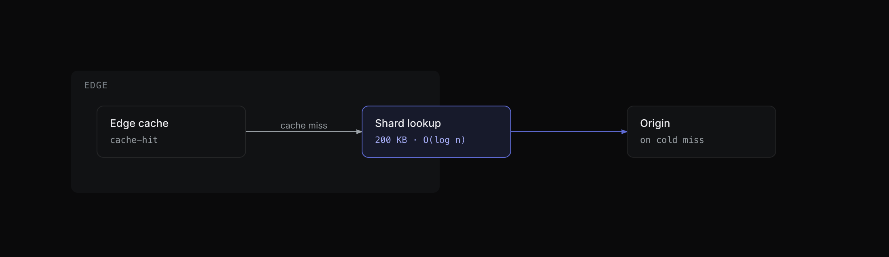
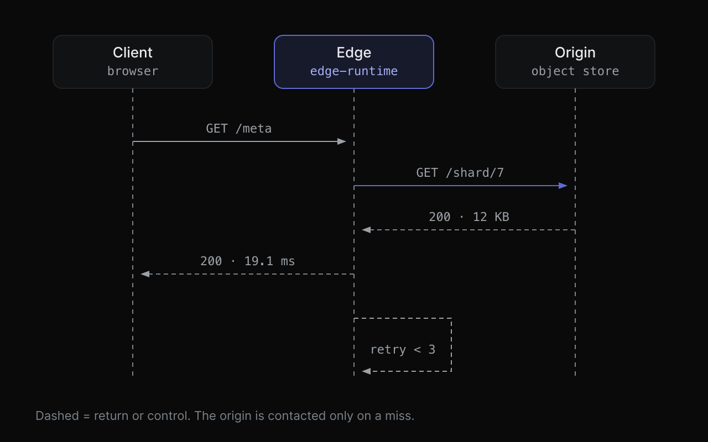
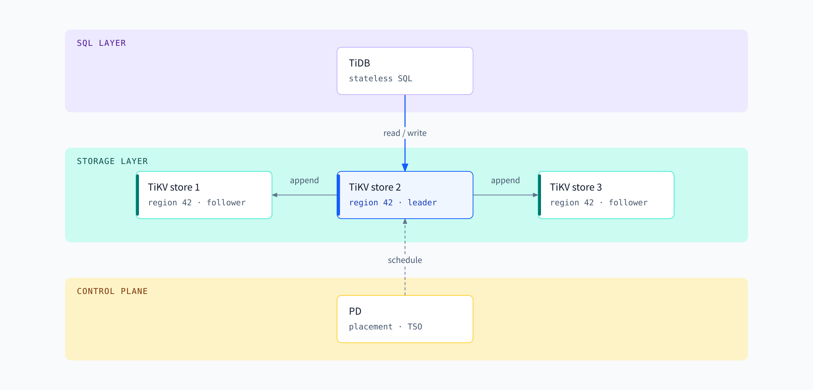

# skills

[English](README.md) · [简体中文](README.zh-CN.md)

[@Loner1024](https://github.com/Loner1024) 的 agent skill 集合。每个 skill 都是一个自洽目录，遵循
[Agent Skills 规范](https://agentskills.io)：一个带 YAML frontmatter 的 `SKILL.md`，加上它自己需要的
references、assets 和 scripts。

一条命令即可装进 Claude Code、Codex、Cursor、Droid、OpenCode、Zed 或
[其他支持的 agent](https://github.com/vercel-labs/skills#supported-agents)。

[](https://skills.sh/Loner1024/skills)

## 安装

```bash
# 先看仓库里有什么
npx skills add Loner1024/skills --list

# 交互式：自己挑 skill、挑 agent、挑安装范围
npx skills add Loner1024/skills

# 非交互：装一个 skill，全局范围，指定 agent
npx skills add Loner1024/skills --skill tech-diagrams -g -a claude-code -a codex -a droid -y

# 全部 skill 装到你装过的所有 agent
npx skills add Loner1024/skills --all
```

不安装，只在单次会话里加载一个 skill：

```bash
npx skills use Loner1024/skills@tech-diagrams | claude
```

之后用 `npx skills update -g` 更新，用 `npx skills remove <skill>` 卸载。

## Skill 清单

| Skill | 做什么 | 依赖 |
| --- | --- | --- |
| [`tech-diagrams`](skills/tech-diagrams) | 产出可发布级技术图表：手写 SVG 加自包含 HTML 预览，交付前自动 lint。覆盖 14 类图，从架构拓扑到序列图、状态机、基准条形、终端窗口框架。同时决定**什么时候不该画图**。 | `python3`、`rsvg-convert`、Chrome/Chromium（渲染 HTML 预览用） |
| [`codebase-design`](skills/codebase-design) | 设计和评审深模块：精确词汇、接缝位置、接缝后面的数据形状、八条设计红牌、一张评审清单。 | 无 |
| [`architecture-ablation`](skills/architecture-ablation) | 通过移除或替换某个组件、层次或机制，并和基线对照，检验它到底贡献了什么。把"这层抽象是不是多余的"变成一个可以复核的证据结论。 | 无 |
| [`external-agent-handoff`](skills/external-agent-handoff) | 把任务收成交接文档和一份可直接转发的 prompt，交给外部 agent 执行；用户带回结果后，再按验收标准逐项检查。当前 agent 不调用外部 agent。 | 无 |
| [`web-craft`](skills/web-craft) | 网页界面打磨的单一入口：先判断任务属于哪一类，再路由到十四个原样搬运的设计工程模块之一（UI 打磨、动效、评审、性能、原型、手机端手感），并原样执行该模块的规则。 | 无 |
| [`unslop`](skills/unslop) | 去掉写作里的 AI 痕迹：8 组共 33 条编号规则，每条都指出模式和解法，按"扫描 → 改写 → 自查"执行。 | 无 |
| [`deslop`](skills/deslop) | 去掉分支 diff 里 AI 生成的代码噪音：复述代码行的注释、可信路径上的防御性检查、只为绕过类型的 `any` 断言、深层嵌套、与周边代码不一致的写法。 | 无 |
| [`create-verification-skill`](skills/create-verification-skill) | 给目标仓库生成项目本地的验证 skill：像用户一样驱动真实应用（启动、体检、驱动、取证、清理），播种按功能拆分的验证地图，交付前端到端实跑一遍证明生成物可用。 | 无 |
| [`writing-for-agents`](skills/writing-for-agents) | 编写和精简 agent 读的文档：skill、`AGENTS.md` / `CLAUDE.md`，或通过指针抵达的文档。覆盖触发词措辞、信息层级、完成标准、leading words 与剪枝，以及 frontmatter 和 model-invoked / user-invoked 的取舍。 | 无 |
| [`reflect`](skills/reflect) | 对一次编码会话做复盘，复盘对象是 agent 的工作环境：三个独立视角（判断、工具、反向）找持久结论，再由 synthesizer 只留下未来 agent 真会照做的东西，每条按频次 × 代价排序，路由到检查、skill、steering 文件或文档。提案后由用户逐行批准，再落地。 | 无 |
| [`design-practice`](skills/design-practice) | 代码之外的产品设计工作，六条路由：设计评审、设计系统审计与组件文档、开发交接标注、UX 文案、用户研究计划、访谈与可用性记录的综合分析。搬运 Anthropic 的 design plugin 作为模块。 | 无 |
| [`nuclear-review`](skills/nuclear-review) | 用最狠的可维护性标准评审 diff：找那步能删掉整层分支、辅助函数和抽象的重构；卡住没有理由的千行文件和到处打补丁的 spaghetti；"测试过了"不构成通过。改自 Cursor 的 `thermo-nuclear-code-quality-review`。 | 无 |
| [`technical-writing`](skills/technical-writing) | 写出疲惫的工程师一遍就能读懂的文档：先选一种 Diátaxis 文档模式，再落到 Google 开发者文风、STE 指令规则和 Global English。覆盖 README、RFC、设计文档、PR 描述和 commit message。 | 无 |
| [`blast-radius`](skills/blast-radius) | 上线前找出 diff 之外的破坏面，并用真实代码跑通整个安全论证所依赖的那一个事实。每个风险按发生概率和代价排序，把已排除的和没能证明的分开写。 | 无 |
| [`benchmark-checklist`](skills/benchmark-checklist) | 在汇报或依据一个性能数字行动之前先审它：找出瓶颈，确认两边都按生产配置调过，对着物理上限做算术，统计错误数，交替重复多轮，避免把噪声当成提升。 | 无 |
| [`tdd`](skills/tdd) | 用一个回归测试修 bug：改之前失败，改之后通过。没有便宜的测试路径时直说，而不是硬搭一套昂贵设施。 | 无 |
| [`correct`](skills/correct) | 把 agent 反复犯的错变成仓库强制的东西：先改架构，再改类型，再加一条错误信息直接说怎么修的 lint，然后补测试，最后才写文档。每条新检查都要在一个真实的历史错误上证明会失败。 | 无 |
| [`sharpen`](skills/sharpen) | 把一个浅的请求改写成更深的请求，而不是更大的：先回答四个问题——这行的顶级从业者会做什么你没要求的事、他们会从什么原始材料开始、用什么方法和工具、除了你和 agent 之外什么能证明结果对。用 `/sharpen` 手动调用。 | 无 |

## tech-diagrams

agent 画的图大多是 Mermaid 方块堆：所有盒子一样大，箭头从空白处起笔，标签被盒子盖住。这个 skill
走的是相反的路——它的规则来自逐篇精读 Linear、Cursor、Vercel、Anthropic、OpenAI 技术写作里**实际怎么放图**。
逐家的原始证据在 [`research/`](research)，但 skill 本身不读它。

每张图交付两个产物：

| 产物 | 用途 |
| --- | --- |
| `<slug>.html` | 自包含预览：内联 SVG 加内联设计 token，无外部请求，离线可开 |
| `<slug>.svg` | 单文件交付件，嵌 README、文档、博客或幻灯片 |

另外附一行 caption（同时就是图片的 `alt`），以及一句话说明这张图**故意省掉了什么**。







### 它强制什么

- **一张图只讲一个结论**，结论写在 caption 里，caption 同时是 `alt`。
- **只有正文承载不了结构时才画**：超过三个对象的对比、多步因果、随时间变化的状态、需要看排名的测量。
  否则它会说"用表格"然后停下。
- **几何预算**：节点最多 9 个，焦点元素最多两个，4px 网格，圆角 ≤ 8px，线宽 1px，只允许正交连线，字号最小 11px。
- **连线卫生**：每个箭头两端都落在看得见的东西上（盒子边框、生命线、起点圆点），箭头不指向角落，
  线不穿过非端点的盒子，短箭头必须带标签。
- **颜色有明确分工。** 一个强调色负责注意力（最多两个焦点元素），最多三个身份色标识并列项与作用域
  （色带、泳道、序列、选项），ok/warn/err 只表示状态。禁止渐变、发光、投影和装饰性 chrome。
- **对比度与中文字体栈由脚本校验**，避免栅格化时静默 tofu。

### 使用流程

```bash
cd skills/tech-diagrams

# 1. 从模板开始（默认 register 是 technical dark）
mkdir -p figures && cp assets/template-dark.html figures/my-figure.html

# 2. 先校验源文件，再看渲染结果
python3 scripts/self_check.py figures/my-figure.html --strict
./scripts/render.sh figures/my-figure.html --scale 2

# 3. 拿源文件和它自己的渲染结果对校（能查出空白图和密度过低）
./scripts/render.sh figures/my-figure.svg --scale 2
python3 scripts/self_check.py figures/my-figure.svg --png figures/my-figure.png

# 改过 reference 文档后，证明里面的代码片段仍然过同一套 lint
python3 scripts/lint_docs.py
```

渲染需要 `rsvg-convert`（macOS 上 `brew install librsvg`）处理 SVG，以及无头 Chrome/Chromium 处理
HTML 预览。linter 只用 Python 标准库。图表是在 macOS 上创作和渲染的；其他平台上 `rsvg-convert` 和
Chrome 的字体解析行为不同，所以中文字体栈是显式列出的。

### 老实说它的边界

linter 只查能查的部分。视觉手感、线宽、这张图到底有没有说服力，仍然需要人眼看一眼 PNG。如果 agent 在某次
会话里无法读图，它会直说，并把渲染结果交给你做最终确认。

## codebase-design

一套设计深模块的词汇和工作流：大量行为藏在小接口后面，接缝干净，测试穿过同一个接口。它给 agent
精确的词（module、interface、implementation、depth、seam、adapter、leverage、locality），让"组件"
"服务""API"不再混用。

设计模式先写调用方用法，再选接缝后面的数据形状，按依赖类型放接缝，探索三个不同约束的接口，最后过
八条 agent 常犯的设计红牌：shallow module、information leakage、temporal decomposition、
pass-through、split ownership、two ways、importable internals、hand-synced list。

评审模式用 deletion test、depth、reader load、boundary、test surface 五个镜头，只报会改变决定的
发现，每条带证据和修法。它不判断服务、缓存、队列该不该存在；那是 `architecture-ablation` 的 job。

## architecture-ablation

问 agent「这个队列有必要吗」，你通常得到的是一个观点。这个 skill 逼它给对照：先锁定必须守住的约束，再每次
只移除或替换一个机制，并把结论归因到带标签的证据上。

它强制了几件靠辩论通常会跳过的动作：

- **先有基线再谈删除。** 约束、关键调用路径、状态归属都要先写下来。如果基线在相关场景下本来就失败，那就
  记录为失败——「两个方案都失败」不算简化通过。
- **假设用统一格式写**，方便追踪：`[假设] <陈述> → 若不成立则影响 <哪个结论>`。
- **用证据标签代替自信的叙述。** 每条结论都标 `实测` / `设计推演` / `待验证`，不允许把预计结果写成已经通过。
- **四种结论，不是两种**：删除或替换、保留、延后引入、待验证。选「保留」必须写出没有它会失败的场景；选
  「延后引入」必须写出把它请回来的可观察条件。
- **单独删都过，推不出一起删也过。** 职责重叠的机制要再做组合复验。
- **复杂度转移了就不算减少。** 最后要确认它有没有跑到调用方、运维流程或另一份状态里去。

用户的目标是约束，不是变量：skill 可以指出某个既定技术栈或边界的代价，但不能靠改变用户的目标去换一个更简单
的方案。局部重构和 ML 模型消融明确不在范围内。

交付的是推荐方案加可复核的证据；单项决策建议直接融进现有设计文档或 ADR，不另生成重复报告。

## external-agent-handoff

工作该交给另一个 agent 时，这个 skill 让当前 agent 停在打包和验收上，自己既不把活做完，也不去调用那个
agent。它先写好方案和检查项，再给出一份文档和一段用户可以原样转发的 prompt。

它强制了几件随口说「你转发一下」时通常会漏掉的动作：

- **文档必须让对方脱离这段对话也能开工。** 目标、起始状态、可写范围、交付物，以及每条验收项对应的可观察检查。
- **prompt 里不留待填空。** 对方能打开文档时，prompt 只指向文档路径；否则把执行内容写进 prompt。
- **交出后停下。** 状态保持为等待外部执行和回传，直到用户带回结果。
- **对照产物验收。** 缺文件的项记为未完成。每条标准都要有当前 agent 自己跑过的结论。失败项要么修好再验，要么写成修订 prompt 送回去。

## web-craft

一个入口，替代十四个 skill 争抢 agent 的注意力。agent 只看到一个 skill；这个 skill 判断任务属于哪一类，
路由到唯一拥有它的模块，然后原样执行模块的规则，不打折。动效评审不会变成设计重写，「这个不该做动效」就是
最终答案。

十四个模块是 [Emil Kowalski](https://github.com/emilkowalski/skills) 的设计工程 skill 集，原样放在
[`modules/`](skills/web-craft/modules) 下，MIT 许可证一并保留。四处机械改动让单一入口成立、并保证托管侧
能加载：模块文件名为 `MODULE.md` 而不是 `SKILL.md`（agent 侧的 skill 发现会把任何嵌套的 `SKILL.md`
当成独立 skill，一个入口会变成十五个）；模块内两处引用该文件名的文字已同步；许可证加上 `.txt` 扩展名；
`break-ui` 里两个字面 U+FFFD 字符改写为转义 `\uFFFD`——托管侧遇到含该字符的文件会整个 skill 不加载。
除此之外与上游逐字节一致。本仓库新增的只有路由层：

- **按任务分类，不按关键词。**「让这个 popover 手感对」是动效构建；「抽屉为什么卡」是性能；「看一下这个
  diff 里的动效」是评审。
- **仅显式调用的模块保持显式。** `review-animations`、`prototype`、`pick-ui-library` 只在用户明确要求这类
  工作、点名该模块、或所路由的模块主动交接时才进入，绝不作为顺手附赠的一步。
- **组合让位于模块自身。** 模块自己的调用变体与交接（`execute <plan>`、`keep <variant>`）优先于本仓库
  建议的任何顺序；两个模块争同一件事时，更专门的那个赢。
- **模块不因任务而改。** 如果模块不适合这件事，那是路由错了，不是模块错了。
- **不属于手艺的设计工作交给隔壁。** 从零搭页面留在这里，但文案要在布局定稿前由 `design-practice` 的 `ux-copy` 写，页面渲染后再回去跑 `design-critique`。Figma 文件或 mockup 不进入这个 skill。

| 任务 | 路由到 |
| --- | --- |
| 构建或打磨 UI | `emil-design-eng` |
| 加动效（网页 / Expo） | `animate` · `animate-expo` |
| 评审 UI / 设计代码（非动效） | `emil-design-eng` |
| 评审、审计、寻找动效 | `review-animations` · `improve-animations` · `find-animation-opportunities` |
| 动效掉帧 | `animation-performance` |
| 手势驱动的流式交互 | `apple-design` |
| 网页在手机上像网站 | `mobile-native` |
| 选 UI 库 · 原型对比 | `pick-ui-library` · `prototype` |
| 边界数据压测 | `break-ui` |
| 给动效命名 | `animation-vocabulary` |
| Sonner toast | `ask-sonner` |

## design-practice

Anthropic 的 design plugin，六个模块加一个路由入口：设计评审、设计系统、开发交接、UX 文案、用户研究、研究综合。模块文字来自插件，删去了其中的无障碍部分；本仓库补的是路由、连接器说明，以及把插件命令变成模块的规则。

与 `web-craft` 的边界看手上是什么：Figma 链接、截图、mockup、标注稿、访谈记录、一行界面文案，走这里；跑着的代码走 `web-craft`。同一个界面，这里判断它能不能用，那里判断它好不好看、顺不顺手。从零搭一个页面时两边会接力：文案在这里写、布局在 `web-craft` 做、渲染出来的页面再回到这里评审。

三处相对上游的改动：模块文件改名 `MODULE.md`，因为 agent 侧发现机制会把任何嵌套的 `SKILL.md` 当成独立 skill；`CONNECTORS.md` 替换了插件自带的那份，让 `~~category` 占位符在安装后的 skill 里仍能解析；无障碍相关内容全部删除，包括 `accessibility-review` 模块、评审框架的第五步，以及交接与组件模板里的无障碍字段。其余部分逐字节一致，Apache-2.0 许可证一并放在 `modules/LICENSE.txt`。

## unslop

只管改写、不管生成：把文本交给它，它去掉那些让它读起来像 AI 写的痕迹。8 组共 33 条编号规则，从空泛的
-ing 短语、模糊归因，到破折号滥用、聊天机器人套话、抽象隐喻名词。每条规则都指出模式和解法，而不是给一个
"感觉"；流程是扫描 → 改写（保义合调）→ 自查。

规则编号是稳定 id，会被其他 skill 引用，所以删掉一条规则会故意留下空号。改这个文件时请保留编号。

## deslop

同一个思路的代码版。它读相对 main 的 diff，删掉模型自作主张加的东西：复述代码行的注释、可信路径上的
防御性检查和 try/catch、只为绕过类型报错的 `any` 断言、该用提前返回拆掉的嵌套，以及与周围文件不一致的写法。

它的护栏才是重点：除非在修明确的 bug，否则行为不变；小改优先于大重写；总结压到 1-3 句。

## nuclear-review

问的是和 `deslop` 相反的问题：不是"模型多加了什么没人要的东西"，而是"如果这个需求一开始就在，我们会搭成现在这样吗"。它对分支改动作一次异常严格的评审，看抽象质量、spaghetti 增长、文件体量、边界干净程度，以及逻辑落在哪一层。

它的核心动作叫 **code judo**：保住行为，删掉整层分支、辅助函数、模式或抽象的那种重构。停在"这里还能再干净点"等于没评审。除此之外有几条硬线：diff 把文件推过 1000 行要有理由；往现有流程里塞特例分支算设计问题，不算风格问题；feature 判断散进公共代码的，退回给它的所有者。

通过门槛在"测试过了"之上。旁边明明有一条可行的简化、却把附带复杂度留着，这是阻塞项而不是建议；结论按优先级排，宁可给几条有把握的重话，也不列一长串鸡毛。正文是 Cursor 那个 thermo-nuclear skill 的原文，只有名字和描述是这里改的。diff 卫生归 `deslop`，接缝位置归 `codebase-design`，某个组件该不该存在归 `architecture-ablation`。

## create-verification-skill

给目标仓库生成它自己的验证 skill（`<skills>/verify-<app>/`）。先只访谈代码库、不问用户：用户实际碰到什么界面、应用怎么启动、怎么程序化驱动、能取什么证据、能不能并行跑两个实例。再写出带 Launch、Doctor、Drive、Evidence、Cleanup、Helpers 六段的 SKILL.md，每一段都以访谈发现为准、不留占位符。

然后播种功能地图：`features/README.md` 索引加每个用户可见功能一个文件，固定四个 H2（Sub-features、How to get to it (user POV)、Driving it with <harness>、Gotchas），样例在 `references/feature-map-example/`。最后必须按生成的 skill 端到端实跑一遍（launch → doctor → 驱动一个功能 → 取证 → 清理，清理后证据必须还在），没跑过的生成物只是草稿。应用变化后，功能地图靠手动更新 `features/` 下的文件来保持诚实。

## technical-writing

Diátaxis 决定文档形状，三层句子标准决定用词。一篇文档只用一种模式——教程、操作指南、参考、解释——因为在教程里塞参考表学不到东西，在参考里塞教程会拖慢查阅。三层之上还有三条：一个词不做事的就删；能用短词就用短词；规则把句子改坏了，就换个写法或者别改。

句子三层是 Google 开发者文风（第二人称、现在时、条件在前、标题说结论）、STE（一句话一条指令、警告放在步骤前、用命令句）、Global English（only 挨着它修饰的词、this 指代不清就重复名词、不用斜杠和分号）。文末有一个改写示例：三句被动的配置说明压成两句。

它管的是给人读的文档的结构和句子。`unslop` 管文字里的 AI 痕迹，`writing-for-agents` 管读者是模型的 `SKILL.md` 和 `AGENTS.md`。

## blast-radius

列出调用方不是正事，agent 一秒就能 grep 完。正事是 grep 看不见的破坏：另一种语言在读的 wire format、feature flag、三跳之后的下游代码、卸载顺序。

方法是找出那一个安全事实。看上去危险的改动，多数只靠一个事实撑着，把时间花在它上面。然后说清楚证明到哪一步：只是你说过、指到了具体行、走完了坏情况进不来、写了脚本跑真实代码，还是在跑着的应用里复现了。第 4 步通常就是一个小脚本，import 应用同一个库，调用你担心的那个函数。一份读起来很顺的论证不算证明，因为它无论真假都读着说服人。

交付分五块：改了什么；那一个安全事实，附证明或直接写 unproven；确认的风险，按概率和代价排序；查过并排除的；合并前最便宜的复现。代码质量归 `nuclear-review`，形状本身的安全归 `codebase-design`。

## benchmark-checklist

性能数字是一个主张，这份清单决定它站不站得住。先找瓶颈再宣布提升：在不上报的那次运行里做 profile，看 CPU、I/O 等待、syscall 和压测端，弄清为什么没有快一倍。确认两边都按生产的方式跑；拿调过的一边比默认配置的一边，比的是配置不是实现。对着带宽和核数做算术，越过物理上限的结果量到的是缓存、空操作或者 bug。

然后统计错误并确认输出正确；每边至少跑 5 次、交替跑，报中位数和区间；任何微基准旁边都要量端到端路径。第 7 问检查的是定时区间里活到底干没干，专抓静默空操作。结论只有四种：更快、更慢、没有可测量的差别、无法判断。说不出瓶颈，或者有一边没调优，"无法判断"就是答案。

## tdd

只有一条规则：改生产代码之前，先让坏行为变成可执行的。测试按预期的原因失败，再用最小的改动让它通过。测试写的是预期行为，不是当前实现，这样重构之后它还成立。

什么时候不写同样重要：要搭一大套 harness、mock 很脆、端到端太慢、只有生产环境才有的状态、fixture 大改，都说明这个回归检查不值得建。宁可不加测试，也不要加一个坏测试，改用最近的可执行检查。护栏：不要为了迁就错误实现去改测试，需求没变就不要削弱断言，测试只盯这个 bug。整应用验证走 `create-verification-skill`，性能数字走 `benchmark-checklist`。

## correct

同一类错误出现两次才算一类。它读最近的提交、回滚、review 评论和解释 workaround 的注释，归出错误类别，然后在能起作用的最高层修掉：改架构，让状态只有一个所有者或者删掉旧路；改类型，让坏状态写不出来；加一条 lint 或 CI 检查，错误信息直接说要换成什么；补一个行为坏了就会失败的测试；文档放最后，因为 agent 跳过文档不会有任何东西失败。

两个细节让它不止是建议。每条新检查都要在一个真实的历史错误上失败，本地和 CI 跑同一条命令；agent 指令文件里的每条规则都要配一个执行者，没有执行者的规则算复发，当次一起修。错误已经不可能发生，规则就删掉。`reflect` 复盘一次会话、给出环境改动建议；这个 skill 是在同一个纠正重复出现之后，把仓库本身改硬。

## sharpen

多数 prompt 改写是在加范围：更多要求、更多边界、更多产出。这个反过来。动 prompt 之前先答四个问题：这行的顶级从业者会做什么你没要求的事；他们会从什么原始材料开始，而不是别人嚼过的版本；他们会用哪些具体方法和工具；除了 agent 和你自己，什么能证明结果是对的。

第四个问题改变的是活本身：它逼出一个不依赖 agent 自信程度的检查。改写后的 prompt 要的正是这个，同时把属于你的选择留空，不替你定。

它交回的是改写后的 prompt，不是任务本身。手动输入 `/sharpen` 调用，不靠模型自己判断。

## 仓库结构

```
research/                        出处材料，不属于任何 skill
  FINDINGS.md                    五家怎么做图，逐家记录，带原始链接
  TAXONOMY.md                    规则背后的决策分类与工具路线调研
scripts/
  sync-to-amp-skills.sh          把 skills/ 同步到维护者的 Amp 个人 skills 仓库
  check-skills.py                校验每个 skill 完整：frontmatter、界面元数据、README、相对链接、触发词、检查码
skills/
  tech-diagrams/
    SKILL.md                     入口：流程、类型路由表、硬规则
    references/                  when-to-draw · registers · primitives · type-* · verification · export
    assets/                      tokens.css 加深色/浅色起始模板
    scripts/                     render.sh · self_check.py · lint_docs.py
    examples/                    八张成品图，覆盖四个内容族
  codebase-design/
    SKILL.md                     入口：词汇、设计模式、评审模式、交接
    references/                  red-flags.md · shape.md
    agents/openai.yaml           界面元数据：显示名、触发词、不触发词
  architecture-ablation/
    SKILL.md                     入口：基线、消融循环、决策表
    agents/openai.yaml           界面元数据：显示名、触发词、不触发词
  external-agent-handoff/
    SKILL.md                     入口：交接文档、转发 prompt、验收
    agents/openai.yaml           界面元数据：显示名、触发词、不触发词
  web-craft/
    SKILL.md                     唯一入口：分发规则、路由表、模块组合
    agents/openai.yaml           界面元数据：显示名、触发词、不触发词
    modules/                     14 个模块，原样来自 emilkowalski/skills，附其 MIT LICENSE
  unslop/
    SKILL.md                     写作：33 条编号规则，去掉 AI 痕迹
    agents/openai.yaml           界面元数据：显示名、触发词、不触发词
  deslop/
    SKILL.md                     代码：从分支 diff 里删掉 AI 噪音
    agents/openai.yaml           界面元数据：显示名、触发词、不触发词
  create-verification-skill/
    SKILL.md                     入口：访谈仓库、生成 verify-<app>、播种功能地图、端到端验证
    references/                  功能地图样例 feature-map-example：索引加每个功能一个文件
    agents/openai.yaml           界面元数据：显示名、触发词、不触发词
  writing-for-agents/
    SKILL.md                     入口：指针、信息层级、完成标准、leading words、剪枝
    references/skill-mechanics.md  frontmatter、调用方式选择、router skill
    agents/openai.yaml           界面元数据：显示名、触发词、不触发词
  reflect/
    SKILL.md                     入口：七处检查点、三个视角、准入标准、排序后的提案表
    CREDITS.md · LICENSE         改写 pstack 的 reflect，并入原 retro，MIT
    agents/openai.yaml           界面元数据：显示名、触发词、不触发词
  design-practice/
    SKILL.md                     入口：按手上的产物路由、模块调用规则
    CONNECTORS.md                `~~category` 占位符，以及每类能拿到什么
    modules/                     6 个模块，取自 anthropics/knowledge-work-plugins，删去无障碍，附其许可证
    agents/openai.yaml           界面元数据：显示名、触发词、不触发词
  nuclear-review/
    SKILL.md                     入口：标准、逐项追问、修法、通过门槛
    CREDITS.md · LICENSE         改自 Cursor 的 thermo-nuclear-code-quality-review，MIT
    agents/openai.yaml           界面元数据：显示名、触发词、不触发词
  technical-writing/
    SKILL.md                     入口：Diátaxis 模式、Google 文风、STE、Global English
    CREDITS.md · LICENSE         取自 pstack 的 technical-writing，MIT
    agents/openai.yaml           界面元数据：显示名、触发词、不触发词
  blast-radius/
    SKILL.md                     入口：证据阶梯、那一个安全事实、风险与已排除
    CREDITS.md · LICENSE         取自 pstack 的 blast-radius，MIT
    agents/openai.yaml           界面元数据：显示名、触发词、不触发词
  benchmark-checklist/
    SKILL.md                     入口：七个问题、结论契约
    CREDITS.md · LICENSE         取自 pstack 的 benchmark-checklist，MIT
    agents/openai.yaml           界面元数据：显示名、触发词、不触发词
  tdd/
    SKILL.md                     入口：先写失败测试、何时跳过、护栏
    CREDITS.md · LICENSE         取自 pstack 的 tdd，MIT
    agents/openai.yaml           界面元数据：显示名、触发词、不触发词
  correct/
    SKILL.md                     入口：错误类别、强制层级、规则表
    CREDITS.md · LICENSE         取自 pstack 的 correct，MIT
    agents/openai.yaml           界面元数据：显示名、触发词、不触发词
  sharpen/
    SKILL.md                     入口：四个问题，然后交回改写后的 prompt
    CREDITS.md · LICENSE         取自 pstack 的 sharpen，MIT
    agents/openai.yaml           界面元数据：显示名、触发词、不触发词
```

`skills/<name>/` 就是安装单元：`npx skills` 复制的正是这一整个目录。这里的每个 skill 都自洽，不读自己文件夹
之外的任何文件，所以从仓库 clone 用和安装后用，行为完全一致。

`research/` 是有意留下的例外：它放在仓库里是为了让人判断某条规则值不值得信，`skills/` 下面没有任何文件读它。
删掉整个目录，所有 skill 照常工作。它用中文写；真正运行用的规则是 `skills/tech-diagrams/references/` 下的英文文件。

## 新增一个 skill

```
skills/<skill-name>/SKILL.md     # frontmatter 要有 name 和 description；名字用小写连字符
```

提交前跑 `python3 scripts/check-skills.py`：缺 `agents/openai.yaml`、只有 `CREDITS.md` 没有 `LICENSE`、
两个 README 里漏了条目、相对链接断了、描述抢了别的 skill 的触发词却没有互相指名、或
`<!-- check:... -->` 标签对不上检查器输出的码，它都会报错。

提交推送后立刻可安装：`npx skills add Loner1024/skills --list` 会自动发现 `skills/` 下的一切。每个 skill
保持自洽，只有运行时才需要的东西放进它自己的文件夹，能用脚本机械校验的规则就别只写成文字。

## 许可

[MIT](LICENSE)。第三方材料在出现处注明出处。
